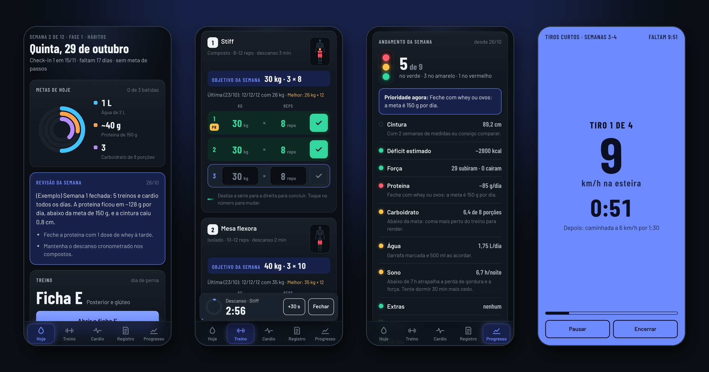
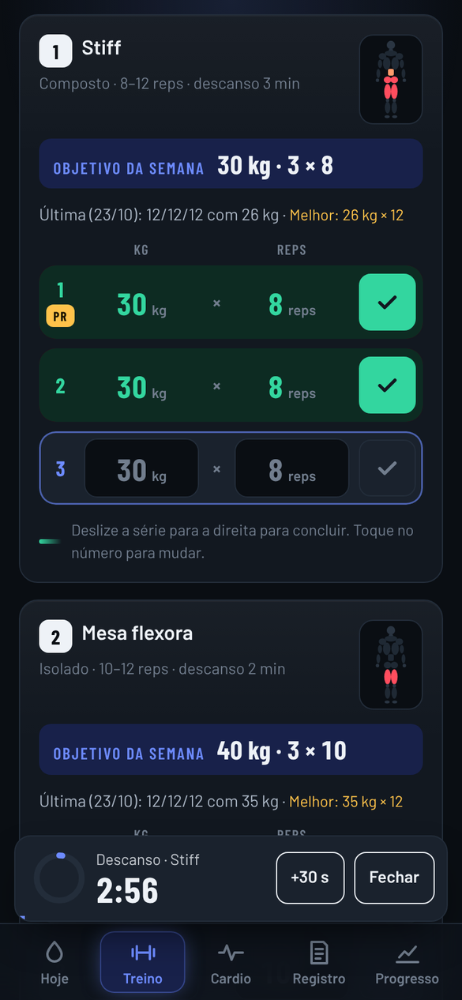
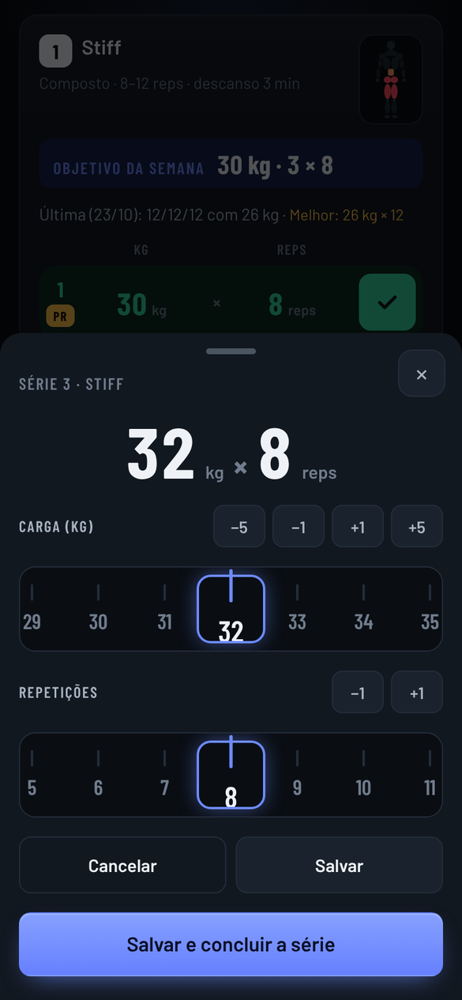
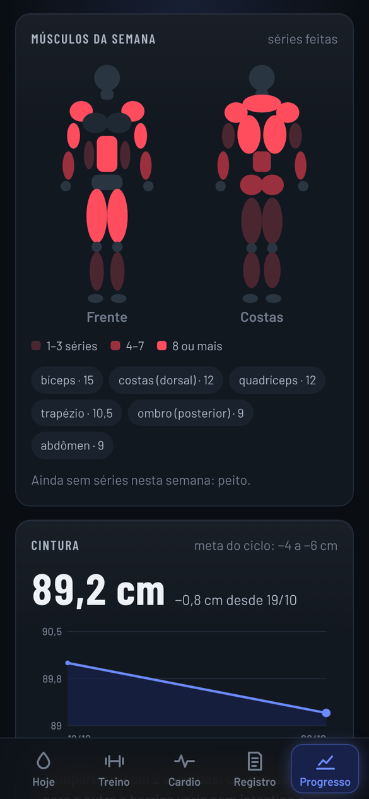
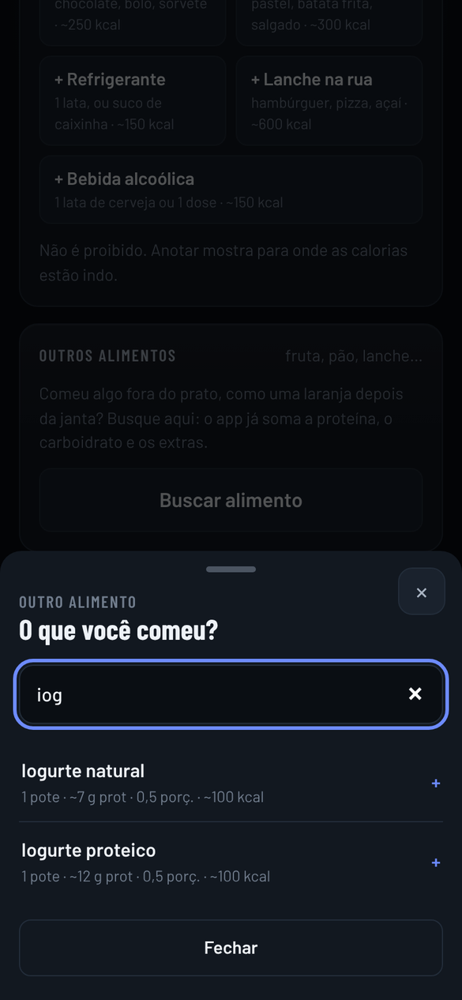

# Diário da Recomposição

App web para celular que acompanha um ciclo de 12 semanas de recomposição corporal (perder gordura e ganhar músculo). Ele junta num lugar só o treino de musculação com progressão automática de carga, o cardio intervalado na esteira, a alimentação do dia e um painel semanal que mostra se o plano está no caminho.

**[Abrir a demonstração](https://tanaka-txt.github.io/diario-da-recomposicao/?demo)** (dados fictícios; funciona melhor no celular)



## Por que eu fiz

Comecei um plano de 12 semanas e precisava de algo que eu usasse de verdade na academia: que dissesse a carga de cada exercício, cronometrasse o descanso e os tiros na esteira e mostrasse, no fim da semana, se eu estava no caminho. Então construí o app em torno do meu plano e fui ajustando a cada treino.

## Funcionalidades

### Treino

- 5 fichas (A a E, 37 exercícios) em rodízio; o app sugere a próxima.
- Objetivo da semana em cada exercício e **progressão automática de carga**: bateu o topo da faixa de repetições nas 3 séries, a carga sobe; ficou abaixo do mínimo, ela baixa. Os incrementos são inteiros porque as máquinas da academia não têm frações.
- Régua de deslizar para escolher carga e repetições; **deslizar a série para a direita conclui**.
- Descanso cronometrado sozinho ao concluir a série, com anel, som e vibração.
- Recordes pessoais com comemoração e selo **PR**.
- Mapa do corpo com os músculos trabalhados em cada exercício.
- Histórico por exercício e por dia, com horário e duração de cada treino.

### Cardio

- Cronômetro de tiros em tela cheia: velocidade, tempo e próxima fase, com bipes e a tela sempre acesa.
- Progressão das linhas de tiros por semana e tiros mais curtos nos dias de perna.

### Alimentação

- Anéis de metas do dia: água, proteína e carboidrato. Eles brilham quando a meta é batida.
- Proteína medida pela palma da mão, doses de whey e ovos; carboidrato por porções; extras com calorias.
- Busca com mais de 70 alimentos comuns, com os mais usados como atalho.
- Refeições, sono e energia em um toque cada.

### Progresso

- **Semáforo da semana**: 10 sinais (cintura, déficit estimado, força, proteína, sono...) em verde, amarelo ou vermelho, com a prioridade do momento.
- Mapa de calor dos músculos treinados na semana.
- Gráfico da cintura (a medida principal) e do peso, que é opcional.
- "O que melhorou": cada exercício comparado com a vez anterior.
- Fotos de progresso sem rosto: o corte é feito no próprio celular, antes do envio (só na versão hospedada no Claude).

### Uso no dia a dia

- **Desfazer** por 5 segundos depois de qualquer toque que muda dados, inclusive o salvamento do treino.
- Animações que só atualizam o que mudou, onda ao tocar e vibração. Se o celular estiver com "reduzir movimento", o app usa uma versão mais suave.
- Tema escuro, pensado para usar com uma mão entre as séries.

| Treino | Ajuste de carga | Músculos da semana | Busca de alimentos |
|---|---|---|---|
|  |  |  |  |

## Tecnologias

| Tecnologia | Para quê |
|---|---|
| HTML, CSS e JavaScript puro | Sem framework e sem etapa de build: o app inteiro é um único `index.html`. |
| SVG | Anéis de metas, mapa do corpo e gráficos. |
| Canvas | Confete dos recordes e corte do rosto nas fotos. |
| APIs do navegador | Pointer Events (deslizar), Vibration, Web Audio (bipes), Screen Wake Lock (tela acesa) e localStorage. |
| [morphdom](https://github.com/patrick-steele-idem/morphdom) | Aplica na tela só as diferenças entre o HTML novo e o atual. |
| [Playwright](https://playwright.dev) | Testes de ponta a ponta num celular simulado. |
| Claude Artifacts | Hospedagem e armazenamento na versão que eu uso no dia a dia. |

## Como funciona por dentro

- **Estado único.** Os dados carregados ficam num objeto `S`. Cada aba tem uma função `render` que monta o HTML como texto.
- **Atualização parcial.** A função `paint()` passa esse HTML pelo morphdom, que mexe só nos elementos que mudaram. Por isso as transições de CSS (barras, anéis, cores) rodam: o elemento continua o mesmo e só o valor muda.
- **Um listener para tudo.** Um único `addEventListener('click')` lê o atributo `data-act` do botão tocado e decide a ação (event delegation).
- **Armazenamento trocável.** Dentro do Claude, o app usa o banco do artifact. Fora dele, usa um adaptador com a mesma interface (`collection(...).onSnapshot`, `doc(...).set`) que grava no `localStorage`. O treino em andamento fica salvo como rascunho no aparelho até você salvar.

Um treino salvo fica assim (coleção `treinos`, documento `2026-10-29-E`):

```json
{
  "data": "2026-10-29",
  "ficha": "E",
  "inicio": "2026-10-29T21:10:00.000Z",
  "duracaoMin": 64,
  "ex": {
    "e1": { "s": [ { "kg": 30, "r": 8 }, { "kg": 30, "r": 8 }, { "kg": 30, "r": 7 } ] }
  }
}
```

Ao salvar, a função `decide()` olha as 3 séries de cada exercício e grava a carga da próxima vez em `config/cargas`.

## Como rodar

Não precisa instalar nada para usar. Dá para abrir o `index.html` direto no navegador ou servir a pasta:

```bash
git clone https://github.com/Tanaka-txt/diario-da-recomposicao.git
cd diario-da-recomposicao
npx serve .
```

Depois abra `http://localhost:3000/?demo`.

- **`?demo`**: carrega dados fictícios com datas relativas a hoje. Nada é salvo, e tudo recomeça ao recarregar.
- **Sem `?demo`**: os seus dados ficam no navegador (localStorage), e o ciclo de 12 semanas começa na segunda-feira da semana do primeiro uso.

## Testes

```bash
npm install
npx playwright install chromium
npm test
```

Os testes abrem o app numa tela de 390 × 844 e conferem:

- metas e semana do ciclo;
- adicionar água e desfazer;
- cancelar o ajuste de carga;
- concluir uma série e desfazer;
- deslizar para concluir;
- salvar o treino e desfazer o salvamento;
- painel da semana sem rolagem lateral;
- dados guardados depois de recarregar a página.

## Como a IA entrou no projeto

Fiz este projeto com o [Claude](https://claude.ai) (Anthropic) como agente de programação. Foi uma conversa longa, em que ele tinha ferramentas para editar arquivos, rodar código e abrir o app num navegador de teste.

**O que ficou comigo:**

- Definir o problema e as regras: o plano em 5 fichas, as metas de alimentação e como a carga deve subir ou descer.
- Escrever as instruções e refiná-las a cada versão (engenharia de prompt): o que o app deve fazer, com exemplos reais do meu dia e o critério do que estava certo.
- Usar o app de verdade na academia e trazer o que não funcionava. Vários recursos nasceram assim: cargas só em números inteiros, tiros mais curtos nos dias de perna, o botão Desfazer depois de toques sem querer e as animações.
- Decidir o que entrava e o que ficava de fora.

**O que o Claude fez:** escreveu a maior parte do código e os testes automatizados, e conferia cada mudança com testes e capturas de tela num celular simulado antes de me entregar a nova versão.

**O que eu aprendi:**

- Escrever requisitos que dão para verificar.
- Revisar o que a IA entrega usando o produto de verdade.
- Trabalhar num ciclo curto com um agente de IA: pedir, testar no uso e corrigir.

## Aviso

O plano de treino e as metas foram montados para mim. Isto não é orientação médica nem nutricional: procure um profissional antes de mudar seu treino ou sua alimentação.

## Licença

[MIT](LICENSE) © 2026 Dev.Tanaka.

O `index.html` inclui o [morphdom](https://github.com/patrick-steele-idem/morphdom), também sob licença MIT ([licenses/morphdom-LICENSE.txt](licenses/morphdom-LICENSE.txt)). A fonte Barlow vem do Google Fonts, sob a SIL Open Font License.

---

Feito por **Dev.Tanaka** · [LinkedIn](https://www.linkedin.com/in/juliocesartanaka) · [GitHub](https://github.com/Tanaka-txt)
